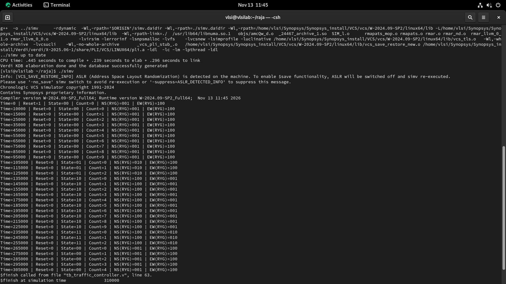
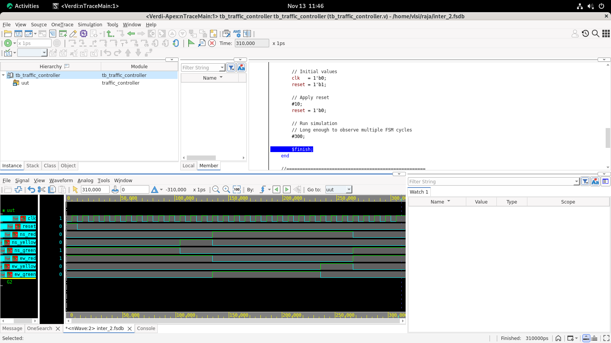

# 🚦 Traffic Light Controller | FSM | Verilog HDL

  
  
  
  

---

## 📌 Project Overview

This project implements a **two-road Traffic Light Controller** using a **Finite State Machine (FSM)** in Verilog HDL.

The controller manages traffic signals for:

- 🚗 North-South (NS) Road
- 🚗 East-West (EW) Road

The FSM ensures safe and sequential switching between **Green, Yellow, and Red** signals.

The design uses a timer-based FSM where each state remains active for a predefined number of clock cycles.

The project includes RTL design, testbench development, functional simulation using Synopsys VCS, and waveform analysis using Synopsys Verdi.

---

## ⚙️ Design Specifications

| Parameter | Description |
|-----------|-------------|
| **Design** | Two-Road Traffic Light Controller |
| **FSM Model** | Moore FSM |
| **Number of States** | 4 |
| **Roads** | North-South and East-West |
| **Green Duration** | 10 Clock Cycles |
| **Yellow Duration** | 3 Clock Cycles |
| **Reset** | Synchronous |
| **HDL** | Verilog |
| **Simulation** | Synopsys VCS |
| **Waveform Analysis** | Synopsys Verdi |

---

## 🔄 FSM State Transition

| Present State | Next State | NS Signal | EW Signal |
|---------------|------------|-----------|-----------|
| **NS_GREEN** | NS_YELLOW | 🟢 Green | 🔴 Red |
| **NS_YELLOW** | EW_GREEN | 🟡 Yellow | 🔴 Red |
| **EW_GREEN** | EW_YELLOW | 🔴 Red | 🟢 Green |
| **EW_YELLOW** | NS_GREEN | 🔴 Red | 🟡 Yellow |

### State Description

- **NS_GREEN** → North-South traffic is allowed to move.
- **NS_YELLOW** → North-South traffic is preparing to stop.
- **EW_GREEN** → East-West traffic is allowed to move.
- **EW_YELLOW** → East-West traffic is preparing to stop.

The FSM continuously cycles through these four states.

---

## 🧠 Traffic Signal Sequence

The controller follows the sequence:

`NS_GREEN → NS_YELLOW → EW_GREEN → EW_YELLOW → NS_GREEN`

### 🟢 NS_GREEN

    NS → GREEN
    EW → RED

The state remains active for **10 clock cycles**.

### 🟡 NS_YELLOW

    NS → YELLOW
    EW → RED

The state remains active for **3 clock cycles**.

### 🟢 EW_GREEN

    NS → RED
    EW → GREEN

The state remains active for **10 clock cycles**.

### 🟡 EW_YELLOW

    NS → RED
    EW → YELLOW

The state remains active for **3 clock cycles**.

The design ensures that both roads can never receive a **Green signal simultaneously**.

---

## ⏱️ Timer-Based FSM Control

A counter is used to determine how long each FSM state remains active.

    NS_GREEN
       │
       ├── Count < 10 → Stay
       │
       └── Count = 10 → NS_YELLOW
                             │
                             ├── Count < 3 → Stay
                             │
                             └── Count = 3 → EW_GREEN
                                                  │
                                                  ├── Count < 10 → Stay
                                                  │
                                                  └── Count = 10 → EW_YELLOW
                                                                       │
                                                                       ├── Count < 3 → Stay
                                                                       │
                                                                       └── Count = 3 → NS_GREEN

The counter resets whenever the FSM transitions to a new state.

This provides predictable timing for each traffic signal state.

---

## 🧪 Simulation and Verification

### Tools Used

- **Verilog HDL** — RTL Design
- **Synopsys VCS** — Functional Simulation
- **Synopsys Verdi** — Waveform Analysis

### Compile

    vcs -full64 -kdb -debug_access+all traffic_controller.v tb_traffic_controller.v -o simv

### Run Simulation

    ./simv

### Open Waveform

    verdi -dbdir simv.daidir &

---

## 📊 Simulation Waveform

### Synopsys VCS

  

  <b>Figure 1: Functional simulation waveform generated using Synopsys VCS.</b>

### Synopsys Verdi

  

  <b>Figure 2: FSM and traffic signal waveforms analyzed using Synopsys Verdi.</b>

---

## 📈 Expected Output

### Traffic Signal Sequence

    NS GREEN
        ↓
    NS YELLOW
        ↓
    EW GREEN
        ↓
    EW YELLOW
        ↓
    NS GREEN
        ↓
    Repeat

### Signal Behavior

    NS GREEN  → EW RED
    NS YELLOW → EW RED

    NS RED    → EW GREEN
    NS RED    → EW YELLOW

The controller continuously repeats the sequence while maintaining safe signal transitions.

---

## 📁 Repository Structure

    Traffic-Light-Controller/
    │
    ├── traffic_controller.v
    ├── tb_traffic_controller.v
    ├── traffic_controller_vcs.png
    ├── traffic_controller_verdi.png
    └── README.md

---

## 🎯 Learning Outcomes

- Understanding **FSM-based digital system design**
- Designing a Moore FSM using Verilog HDL
- Implementing traffic signal sequencing
- Implementing counter-based state timing
- Designing synthesizable RTL
- Writing Verilog testbenches
- Performing functional simulation using **Synopsys VCS**
- Debugging RTL using **Synopsys Verdi**
- Analyzing FSM and timing waveforms
- Understanding practical RTL verification flow

---

## 🚀 Future Improvements

- 🚗 Vehicle detection using sensors
- 🚦 Adaptive traffic signal timing
- 🚑 Emergency vehicle priority
- 🚶 Pedestrian crossing control
- 📊 Traffic-density-based signal optimization
- 🌐 Multiple intersection coordination
- 🔧 FPGA implementation with physical LEDs
- SystemVerilog assertions
- Functional and code coverage
- RTL synthesis and PPA analysis
- Timing analysis
- RTL-to-GDSII implementation

---

  <b>Author: Hariharan D</b>
   
  <i>Designed and Simulated using Verilog HDL | FSM | Synopsys VCS | Synopsys Verdi</i>

